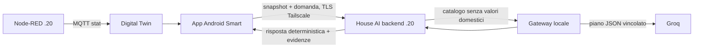

# Modalità Smart — dominio climatizzazione

Stato del 13 settembre 2026: primo incremento read-only per spiegare lo stato
dichiarato del condizionatore e il motivo registrato dal controller Node-RED.

## Obiettivo e significato della risposta

Le domande «perché il condizionatore è acceso?» e «perché è spento?» vengono
interpretate dal gateway Groq, che può scegliere soltanto il tool chiuso
`current_air_conditioner`. Il modello non vede credenziali domestiche, non legge
MQTT e non formula la risposta finale. Il backend valida il piano e compone in
modo deterministico stato, modalità aria, setpoint e motivo disponibili.

La frase «motivo registrato dal controller» è intenzionale: descrive il testo
pubblicato da Node-RED, senza trasformarlo in prova fisica o in una nuova
deduzione causale. Il flag retained e il timestamp di ricezione Android vengono
conservati; non dimostrano la freschezza della misura sorgente. Un dato mancante
rimane mancante e non viene convertito in spento, zero o temperatura predefinita.

## Contratto dati validato

L'app sottoscrive il prefisso Digital Twin già esistente e accetta esclusivamente
questi record di stato:

| Campo interno | Topic MQTT esatto |
|---|---|
| `current_state` | `zara/interface/stato_condizionatore/stato_attuale/stat` |
| `air_mode` | `zara/interface/stato_condizionatore/modalita_aria/stat` |
| `temperature_set_c` | `zara/interface/stato_condizionatore/temperatura_impostata_c/stat` |
| `recorded_reason` | `zara/interface/stato_condizionatore/motivo_logica/stat` |

I topic `/cmd`, campi sconosciuti, payload vuoti, setpoint non numerici e
osservazioni più vecchie vengono scartati. Android invia al backend lo snapshot
`house_ai.current_climate_input.v1`, con valore originale, topic, ricezione e
retained. Il backend ripete la validazione e richiede la corrispondenza esatta
fra campo e topic prima di eseguire il tool.

## Architettura della domanda e del seguito «perché?»

Dopo una risposta prodotta con `current_air_conditioner`, il backend restituisce
soltanto il contesto `{domain: climate, focus: air_conditioner}`. La schermata lo
mantiene in memoria e lo rimanda con la domanda successiva. Il backend espande
un «perché?» isolato in una domanda esplicita prima di chiamare il planner. Ogni
altro contesto viene rifiutato. Non viene salvata la conversazione, non vengono
rimandate risposte precedenti e non esiste memoria libera controllabile dal
testo dell'utente.

## Componenti e replica

Non sono necessari nuovi pacchetti, porte, servizi, chiavi o permessi. Restano
gli stessi componenti descritti in [GATEWAY_MODELLO.md](GATEWAY_MODELLO.md) e
[DEPLOYMENT_20_TLS_2026-09-13.md](DEPLOYMENT_20_TLS_2026-09-13.md): backend e
gateway Python standard library su `.20`, Groq via HTTPS, Tailscale Serve verso
il solo backend e broker/Digital Twin esistenti. `.15` resta il server EmonCMS e
non partecipa alla lettura dello stato corrente del climatizzatore.

Per replicare su un Raspberry più potente, installare la stessa release del
repository con la procedura atomica già documentata, riusare i template systemd
e configurare i file privati `/etc/house-ai`. Non copiare chiavi nel repository.
L'app deve raggiungere l'URL HTTPS della nuova macchina tramite la tailnet; il
gateway continua ad ascoltare soltanto su loopback.

## Verifica e rollback

La suite locale copre topic ammessi, provenienza, retained, valori mancanti,
setpoint invalido, contesto valido/non valido, piano chiuso e presentazione del
motivo. La compilazione Android verifica il collegamento fra MQTT, repository e
schermata Smart. La verifica reale e la revisione distribuita sono registrate
nel documento di deployment dopo l'attivazione su `.20`.
La prova eseguita è disponibile in
[VERIFICA_CLIMATIZZAZIONE_2026-09-13.md](VERIFICA_CLIMATIZZAZIONE_2026-09-13.md).

Il rollback non richiede modifiche a MQTT o Node-RED: si ripunta
`/opt/domopi-house-ai/current` alla release backend precedente e si riavviano
`house-ai-gateway` e `house-ai-backend`. L'APK precedente ignora semplicemente
i nuovi campi; nessun comando verso il climatizzatore è stato aggiunto.

## Fase 3.2 — termostati riscaldamento (ottobre 2026)

Il condizionatore resta **non comandabile**: lo pilota solo il controller AI
Climate (`61992c8879c11f66`) con codici IR Broadlink, e il Digital Twin non
espone comandi per esso. La 3.2 aggiunge i due termostati del riscaldamento,
che il Router già instrada verso Tasmota (`TEMPTARGETSET`).

| Tool | Parametri | Effetto |
|---|---|---|
| `current_thermostats` | `all`, `thermostat_living`, `thermostat_bath` | temperatura ambiente, setpoint, richiesta di calore del termostato ("chiede / non chiede calore"), min/max del timer |
| `current_heating` | nessuno | caminetto (acceso, livello, modalità, orari, potenza automatica), puffer alto/basso/ACS, pompa pavimento abilitata/in funzione, caldaia (fiamma, modulazione), solare termico; **solo lettura** |
| `set_fireplace_settings` | `mode` (5 etichette o `unchanged`), `start_time`/`stop_time` (HH:MM o `unchanged`), `auto_power` (`on`/`off`/`unchanged`) | `command_ready` → l'app pubblica su `zara/interface/fireplace/main/{mode,start_time,stop_time,auto_power}/cmd`; `rejected` se l'avvio non precede lo spegnimento (con gli orari attuali) |
| `set_fireplace_power` | `state` `on`/`off` | `confirmation_required` solo se la modalità è `Manuale` (o messa a Manuale nello stesso piano); `rejected` altrimenti, `unchanged` se già nello stato chiesto; l'app invia `power/cmd` solo dopo "Conferma" e solo se riceve ancora `Manuale` |
| `set_thermostat_target` | termostato + `target_c` da 16.0 a 22.0 a passi di 0.5 | comando `house_ai.thermostat_command.v1`, senza topic |

Android invia `current_heating` (`house_ai.current_heating_input.v1`) con i topic `/stat` del
Digital Twin elencati in `HEATING_METRICS` (`energy_tools.py`) e `HeatingSmartState.kt`; valori non
validi vengono scartati dall'app e rifiutati dal backend (14/10/2026).

Android invia `current_thermostats` (`house_ai.current_thermostats_input.v1`)
con chiavi `thermostat_*.metrica` e il topic `/stat` esatto. Il backend rifiuta
topic, tipi o valori fuori allowlist. Il comando segue lo schema delle luci:
il planner sceglie solo termostato e valore da un enum chiuso, il parser
Android lo ricontrolla e `MqttManager.setSmartThermostatTarget` pubblica su
`zara/interface/climate/{termostato}/target_temperature/cmd`. Esecuzione
immediata, senza conferma (decisione utente).

Limiti dichiarati nelle risposte:

- lo `/stat` del setpoint è l'eco di `cmnd/.../TEMPTARGETSET`, non una lettura
  del termostato;
- min/max sono i setpoint del timer delle fasce orarie, che gira su `.15`
  (tab «TASMOTAs», export utente del 10/10/2026): `light-scheduler` per
  soggiorno e bagno, varianti «SOLO caminetto» (attive con
  `palazzettiModalita = inverno`) e «Con Caldaia» (`conCaldaia`). In fascia
  pubblica **max**, fuori fascia **min**, su `cmnd/.../TEMPTARGETSET`. Il
  timer riscrive il setpoint al cambio fascia, quando min/max cambiano e con
  l'inject «trigger» ogni 8 ore: un setpoint impostato dall'AI dura fino al
  primo di questi eventi;
- su `.20` la modalità vacanza riporta i termostati a 17 °C ogni 2 ore (nodo
  «regolazione termostati a 17»); i vecchi `light-scheduler` dei termostati su
  `.20` sono disabilitati;
- `tasmota_F294D7` (timer attivo su `.15`, 11 °C dalle 4 alle 6, e nodi MQTT su
  `.20`) è un termostato **dismesso** secondo l'utente (10/10/2026): flussi
  residui da ripulire, non fa parte del catalogo Smart.

Nessuna modifica a Node-RED né al Predictive Reserve. Nella stessa fase lo
slider del setpoint (`HvacScreen`) invia un solo comando al rilascio invece di
uno per ogni movimento.

Rollback: release backend precedente (il catalogo non espone più i tool) e APK
precedente. Ordine di deploy: prima il backend, perché un backend precedente
rifiuta con 400 il nuovo campo `current_thermostats`.
